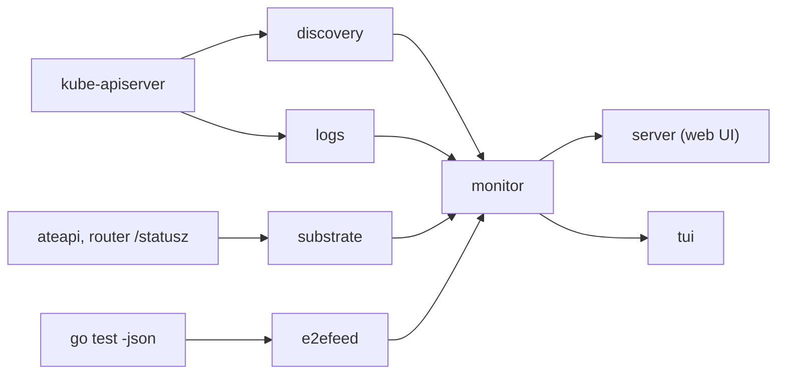

# e2e-monitor

`e2e-monitor` is a local, read-only dashboard for a cluster running Agent Substrate. It shows what every substrate component is doing and how each e2e test moves through them. It has two frontends with the same features: a web UI in the browser and a terminal UI (TUI).

- **One tab per component.** Every Deployment, DaemonSet, and StatefulSet in the system namespace gets a tab, so a new component appears without code changes. Each tab shows the component's pods, container states, restarts, recent events, and live logs.
- **Workers.** Every WorkerPool and its worker pods, plus ateapi's view of the registered workers and the actors running on them.
- **E2E.** The progress of an e2e run, read from its `go test -json` stream. For each test it builds a **timeline**: the test's output merged with every component log line that mentions a resource the test created. The timeline shows the test's path through ateapi, atecontroller, atelet, the router, and the worker pods.

It lives under `internal/x/`, so it is experimental and has no compatibility guarantees.

- [Quick start](#quick-start)
- [Attaching an e2e run](#attaching-an-e2e-run)
- [Web UI](#web-ui)
- [Terminal UI](#terminal-ui)
- [How tests are tied to component logs](#how-tests-are-tied-to-component-logs)
- [Which logs are kept](#which-logs-are-kept)
- [Flags](#flags)
- [JSON API](#json-api)
- [Troubleshooting](#troubleshooting)
- [Architecture](#architecture)
- [Security](#security)

## Quick start

You need a cluster with Agent Substrate installed (for example, from `hack/install-ate-kind.sh`) and a kubeconfig that reaches it. The monitor uses the current context unless you pass `--context`.

```shell
# Watch the cluster in the browser at http://127.0.0.1:8080.
go run ./internal/x/e2e-monitor serve

# The same in the terminal, with no web server.
go run ./internal/x/e2e-monitor serve --tui --listen=

# Run e2e tests through the monitor and watch them in the terminal.
go run ./internal/x/e2e-monitor run --tui -- hack/run-e2e-kind.sh ./internal/e2e/suites/demo -run TestActorLifecycle
```

With no subcommand, `e2e-monitor` behaves like `serve`.

## Attaching an e2e run

The E2E tab reads test2json events, the stream `go test -json` writes. There are three ways to feed it.

### Run the tests through the monitor

```shell
go run ./internal/x/e2e-monitor run -- hack/run-e2e-kind.sh ./internal/e2e/suites/networking -args --preview=ALL
```

`run` starts the command after `--` and adds `-json` just before its `-args` separator, or at the end if there is none. Both `go test` and `hack/run-e2e.sh` pass flags before `-args` to `go test`. If `-json` is already present, `run` leaves the command unchanged.

- **Without `--tui`**, the usual human-readable output still goes to the terminal; tracking markers are left out (see [below](#how-tests-are-tied-to-component-logs)). The dashboard keeps serving after the command exits, until you press Ctrl-C. Add `--exit-when-done` to exit as soon as the command does.
- **With `--tui`**, the command's output and stderr go to the E2E tab instead of the terminal.
- Ctrl-C interrupts the command and waits up to 30 seconds for it to run its cleanups.
- `e2e-monitor` exits non-zero when the command fails.

> [!IMPORTANT]
> Do not set `E2E_JUNIT_FILE` with `run`. It makes `hack/run-e2e.sh` run the tests under gotestsum, which prints text rather than JSON, so the E2E tab stays empty. To keep the JUnit file, use the next method instead.

### Follow a file another run is writing

```shell
# Terminal 1: a CI-style run. It writes /tmp/e2e.json next to the JUnit file.
E2E_JUNIT_FILE=/tmp/e2e.xml hack/run-e2e-kind.sh ./internal/e2e/suites/demo

# Terminal 2:
go run ./internal/x/e2e-monitor serve --e2e-json=/tmp/e2e.json
```

`--e2e-json` waits for the file to appear and keeps reading as it grows. Any test2json file works, for example `go test -json ... > /tmp/e2e.json`.

### Replay a recorded run

```shell
go run ./internal/x/e2e-monitor serve --e2e-json=artifacts/e2e-gvisor.json --replay
```

`--replay` reads the file once, for example a CI artifact. The test tree and output are complete. The cluster tabs still show the live cluster. Timelines can only correlate logs the monitor has in memory, so a replayed run gets component logs only if the monitor was running during it.

> [!TIP]
> Start the monitor before the tests. It only has logs from when it began following each container, plus the last `--tail-lines` lines from before that. Worker pods of a test are only followed while the test is running.

## Web UI

The web UI is served at `--listen` (default `http://127.0.0.1:8080`). It updates live over server-sent events. The header shows the context, the namespace, and the state of the live connection.

### Overview

A card for each component (health, ready replicas, pod count, restarts, warning events), one for the worker pools, and one for the e2e run. Click a card to open its tab.

A component's health is **ok** when all of its replicas are ready, **degraded** when some are, **down** when none are, and **unknown** when it wants no replicas.

### Component tabs

There is one tab for each workload, named after it. Pods that no workload selects (Jobs, bare pods) are grouped under `other-pods.<namespace>`.

- **Pods**: phase or failure reason (such as `CrashLoopBackOff`), ready containers, restarts, node, age, and a chip for each container. Hover over a chip to see its image and state. Click a row to show that pod's logs.
- **Logs**: the log viewer, which starts on all pods of the component.
  - Pick one pod and container, a minimum level, or a text filter.
  - **follow** keeps the newest line in view. Scrolling up turns it off; scrolling back to the bottom turns it on again.
  - **pause** holds new lines and shows how many are waiting.
  - **previous** opens the logs of the previous instance of a restarted container in a new window. It needs a pod and a container to be selected.
  - Click a line to expand its JSON.
- **/statusz** (`atenet-router` only): the router's mode, build, parking state, health, and recent queries.
- **Events**: the latest Kubernetes events for the workload, its ReplicaSets, and its pods.

### Workers

- **Pools**: namespace, ready and desired replicas, pod count, sandbox class, and whether an e2e test owns the pool. Pools of e2e tests link to their test. Click a row to expand its pods, then click a pod to stream its logs. Opening a pod's logs starts following it if it was not followed already (see [Which logs are kept](#which-logs-are-kept)). Empty e2e pools are hidden unless you check **show empty e2e pools**.
- **ateapi state**: the workers registered with ateapi and the actors on each, and every actor with its state, worker pod, and crash message. The actor list has its own filter.

### E2E

- **Left**: the source of the run, its state, pass/fail/skip/running counts, and the test tree grouped by package. Running tests show how long they have been running and their latest output line.
- **Right**, for the selected test:
  - Its state, duration, and the resources it is tied to, shown as chips such as `namespace: abcd-123` and `actor: demo/counter-1`.
  - **Timeline**: a swimlane chart with one row per component and a mark for each entry (errors and warnings in red and yellow). Below it is the merged list. Click a mark to jump to its row. Use the lane checkboxes to hide components. Check **own resources only** to correlate only what this test tracked itself, ignoring resources it shares with its parent and siblings.
  - **Output**: the test's raw output.
- With no test selected, the failures are listed for quick access.

URLs are stable, so you can share them: `#/c/atelet`, `#/workers`, `#/e2e/<package>.<TestName>/<subtest>`.

## Terminal UI

```shell
go run ./internal/x/e2e-monitor serve --tui
```

The TUI has the same tabs as the web UI. The header shows the context, the namespace, and the live run counts (`✓` pass, `✗` fail, `●` running, `↷` skip).

- **Overview**: one row per component, then Workers and E2E. Press `enter` to open the selected row.
- **Component tabs**: a pod list (the first row is "all pods") above a live log pane. The title line of the pane shows what it is displaying: pod/container, level, filter, follow state, and line count.
- **Workers**: pools and their pods. Select a pod to stream its logs; press `a` to see ateapi's workers and actors instead.
- **E2E**: the test tree on the left; the selected test's timeline (colored by component) or output on the right. A running test's timeline refreshes every two seconds.

| Key | Action |
|---|---|
| `←`/`→`, `h`/`l`, `tab`/`shift+tab` | Previous / next tab |
| `1`-`9` | Jump to a tab |
| `↑`/`↓`, `k`/`j` | Select a pod (component and Workers tabs) or a test (E2E tab) |
| `enter` | Overview: open the selected row |
| `pgup`/`pgdn`, `ctrl+u`/`ctrl+d` | Scroll the log or detail pane by half a page |
| `J`/`K` | Scroll one line |
| `g`/`G` | Top / bottom of the pane (`G` also resumes following) |
| `f` | Toggle following new lines |
| `w` | Toggle wrapping long lines |
| `v` | Cycle the minimum log level: all, INFO, WARN, ERROR |
| `c` | Cycle the container of the selected pod |
| `/` | Filter text; `enter` applies, `esc` cancels |
| `esc` | Clear the filter |
| `e` | Component tab: events instead of logs |
| `a` | Workers tab: ateapi state instead of logs |
| `t` | E2E tab: switch between timeline and output |
| `o` | E2E tab: correlate only the test's own resources |
| `r` | Reload everything |
| `?` | Help |
| `q`, `ctrl+c` | Quit |

The mouse wheel scrolls the log and detail panes.

The web UI is still served while the TUI runs, unless you pass `--listen=` (empty). Because the TUI owns the terminal, the monitor writes its own log to a temporary file and prints the path when it exits.

## How tests are tied to component logs

Component logs don't say which test caused them, so the monitor matches log lines against the resources each test created.

### Tracking markers

When a shared helper in `internal/e2e` creates a resource, it calls `e2e.Track`, which writes one line to the test log:

```
    namespace.go:89: E2E-MONITOR {"kind":"namespace","name":"abcd-123"}
```

test2json attributes each line to the test that wrote it, so the marker needs no test name. The format is defined in [`internal/e2e/e2etrack`](../../e2e/e2etrack/e2etrack.go).

| Helper | Tracks |
|---|---|
| `e2e.CreateNamespace` | The namespace. It also annotates it with `ate.dev/e2e-test=<test name>`, so a namespace a failed run left behind can still be traced to its test. |
| `e2e.DeploySubstrateFixture` | The fixture's atespace, and the namespace of its pool, which has the same name |
| `e2e.ResumeActorAwaitCapacity` | The actor |

A test that creates resources directly should track them itself so its logs can be correlated:

```go
actor, err := clients.SubstrateAPI.CreateActor(ctx, req)
// ...
e2e.TrackActor(t, actor.GetMetadata().GetAtespace(), actor.GetMetadata().GetName())

e2e.Track(t, e2etrack.Ref{Kind: e2etrack.KindWorkerPool, Namespace: ns, Name: "pool"})
```

The kinds are `namespace`, `atespace`, `actor` (with `Atespace`), and `workerpool` (with `Namespace`).

### Which resources count for a test

By default, a test's timeline uses:

- the resources the test tracked itself,
- those of its parent tests, since a parent usually deploys the fixture its subtests use,
- those of its subtests,
- and any namespace annotated with its name or a subtest's name.

Parallel subtests often share a fixture namespace, so each one's timeline also shows its siblings' activity. **own resources only** (web) or `o` (TUI) narrows the timeline to the resources the test tracked itself.

### Which lines match

A component log line matches a test when:

- it comes from a pod in one of the test's namespaces (the test's worker pods), or
- its `ate.atespace` or `ate.actor.name` attribute names one of the test's atespaces or actors, or
- its raw text mentions one of the test's resources, for example in an object path (`.../atespaces/<atespace>/actors/...`), a pod reference (`<namespace>/<pod>`), or a request dump (`"atespace":"<atespace>"`).

Names of 8 or more characters, such as the generated namespace names (`abcd-123`), are matched anywhere in the text. Shorter names, such as the shared `demo` atespace, are matched only in key/value or path form, so ordinary words don't cause false matches.

The timeline covers from 2 seconds before the test started to 10 seconds after it ended, and holds at most 3000 log lines. When it is capped, the oldest lines are dropped and the UI says so.

## Which logs are kept

- **Components**: every long-running container (including native sidecars) of every component pod is followed all the time. When a stream drops, it reconnects from its last timestamp without duplicating lines.
- **Workers**: followed according to `--follow-workers`:
  - `e2e` (default): the worker pods in the namespaces of tests that are running now.
  - `all`: every worker pod.
  - `none`: only pods you open.
- **On demand**: any pod you open in either UI is followed until five minutes after you last viewed it.
- Each container keeps its last `--buffer-lines` lines (default 5000) in memory. A new stream starts with the last `--tail-lines` lines (default 500).
- Lines from a container that stopped being followed (its pod was deleted, or its test ended) stay readable for 30 minutes. That keeps a failed test's worker logs available after `internal/e2e` deletes its namespace.
- Times are shown in local time. A line is dated by its own `time` field when it has one, otherwise by the kubelet's timestamp.

## Flags

These apply to both `serve` and `run`.

| Flag | Default | Meaning |
|---|---|---|
| `--kubeconfig` | standard loading rules | Kubeconfig file |
| `--context` | current context | Kubeconfig context |
| `--listen` | `127.0.0.1:8080` | Web UI address; empty serves no web UI |
| `--tui` | `false` | Run the terminal UI |
| `--namespace` | `$ATE_NAMESPACE` or `ate-system` | Substrate's system namespace |
| `--extra-namespace` | `podcertificate-controller-system` | More namespaces whose workloads become tabs (repeatable) |
| `--resource-prefix` | `$E2E_RESOURCE_PREFIX` | Prefix a packaged install puts on resource names |
| `--follow-workers` | `e2e` | `e2e`, `all`, or `none`; see [Which logs are kept](#which-logs-are-kept) |
| `--substrate-api` | `true` | Poll ateapi and the router's `/statusz` every 5 seconds |
| `--tail-lines` | `500` | Existing lines loaded when a container starts being followed |
| `--buffer-lines` | `5000` | Lines kept in memory per container |
| `-v`, `--verbose` | `false` | Debug logging |

| Subcommand flag | Default | Meaning |
|---|---|---|
| `serve --e2e-json` | | test2json file to follow |
| `serve --replay` | `false` | Read `--e2e-json` once instead of following it |
| `run --exit-when-done` | `false` | Exit when the command exits |

## JSON API

The web UI is built on a JSON API, which also works from scripts:

```shell
curl -s localhost:8080/api/e2e | jq '.counts'
curl -s 'localhost:8080/api/logs?component=atelet&level=ERROR&limit=50' | jq -r '.[].raw'
```

| Endpoint | Returns |
|---|---|
| `GET /api/info` | Context, system namespace, follow mode |
| `GET /api/components`, `/api/components/{name}` | Components with pods and events |
| `GET /api/pools` | Worker pools with pods |
| `GET /api/namespaces` | e2e namespaces and the test that created each |
| `GET /api/substrate` | ateapi workers and actors, router `/statusz` |
| `GET /api/logs` | Matching log lines; parameters: `component`, `pod` (`NAMESPACE/NAME`), `container`, `level`, `q`, `since` (RFC 3339), `limit` |
| `GET /api/logs/stream` | The same as server-sent events: a `backlog` event, then `lines` batches |
| `GET /api/logs/previous?pod=&container=` | The previous container instance's logs, as text |
| `GET /api/streams` | Every log stream and its state |
| `GET /api/e2e` | Run summary and test tree, without output |
| `GET /api/e2e/test?id=` | One test with output and resources; `id` is `<package>.<TestName>` |
| `GET /api/e2e/package?name=` | One package with its output |
| `GET /api/e2e/timeline?id=&scope=own` | A test's timeline |
| `GET /api/events` | Server-sent events naming what changed: `components`, `e2e`, `substrate` |

## Troubleshooting

| Symptom | Cause and fix |
|---|---|
| `watching the cluster: informer caches did not sync` | The cluster is unreachable or your credentials can't list the watched resources. Check `kubectl get pods -n ate-system` with the same context. |
| Log warning: `WorkerPools unavailable; deriving pools from worker pod labels` | The WorkerPool CRD isn't installed or you can't list it. Pools are built from the `ate.dev/worker-pool` pod label, and their replica counts are inferred from the pods. |
| ateapi or `/statusz` banner in the Workers or router tab | The monitor reaches ateapi through a port-forward, with a token minted for the `ate-client` ServiceAccount, the same way `kubectl ate` does. That needs `pods/portforward` and `serviceaccounts/token` permissions in the system namespace. It retries every 5 seconds. `--substrate-api=false` turns this off. |
| E2E tab stays empty under `run` | `E2E_JUNIT_FILE` is set (see [above](#run-the-tests-through-the-monitor)), or the command isn't `go test` or a wrapper that passes flags to it. |
| A timeline shows only the test's output | The test tracked no resources: the detail pane says so. Add `e2e.Track` calls. Or the logs it caused were written before the monitor started. |
| A timeline lacks the test's worker logs | The worker pods were not followed while the test ran: the monitor started late, the run was not attached, or `--follow-workers=none`. Start the monitor first, or use `--follow-workers=all`. |
| A subtest's timeline is noisy | Its siblings share its fixture namespace. Use **own resources only** / `o`. |
| The timeline says log lines were capped | A test produced more than 3000 matching lines; the oldest are dropped. Narrow it with **own resources only**. |
| A deleted pod's logs disappeared | They are kept for 30 minutes after the pod goes away. |
| `address already in use` | Another monitor is running. Pick another `--listen` port, or pass `--listen=` with `--tui`. |
| The TUI looks garbled | It needs a terminal with color and Unicode support. The monitor's own log is in the temporary file it prints on exit; add `-v` for more detail. |

## Architecture

```
internal/x/e2e-monitor/
  main.go               flags, wiring, serve / run
  internal/discovery    informers -> components, pools, e2e namespaces
  internal/logs         per-container log followers, ring buffers, JSON parsing, fan-out
  internal/e2efeed      test2json reader, test tree, tracked resources, log matcher
  internal/substrate    ateapi workers/actors and router /statusz poller
  internal/monitor      frontend-neutral read model, log queries, timelines, follow policy
  internal/server       web frontend: JSON API, server-sent events, embedded UI (web/)
  internal/tui          terminal frontend (Bubble Tea)
internal/e2e/e2etrack   the tracking marker format shared with internal/e2e
```



- **discovery** uses shared informers, so it never polls. It attaches each pod to the workload whose selector matches it. Descriptions and `/statusz` ports come from a small table of known components (`discovery/known.go`), but a workload missing from that table still gets a tab.
- **logs** follows `pods/log` streams into per-container ring buffers, parses substrate's JSON log lines (time, level, message, `ate.*` attributes), and fans new lines out to subscribers.
- **e2efeed** keeps each test's state, output, and tracked resources. It also provides the matcher that decides whether a log line belongs to a set of resources.
- **substrate** polls ateapi (`ListWorkers`, `ListActors`) and the router's `/statusz` through port-forwards. Failures are reported in the UI and never stop the monitor.
- **monitor** is the only thing the frontends use. It provides component and pool snapshots, log queries and subscriptions (`LogQuery`, `Subscribe`), test details and timelines, and change notifications by topic. It also decides which containers' logs are followed. The two frontends share no code with each other. The TUI depends on `monitor` through the small `tui.Source` interface. A new frontend needs only `monitor.Monitor`.
- **monitortest** (`monitor/monitortest`) builds a `Monitor` over a fake cluster for frontend tests.

Run the tests with:

```shell
go test -race ./internal/x/e2e-monitor/... ./internal/e2e/e2etrack/
```

## Security

- The monitor only reads from the cluster: it watches resources, reads logs, port-forwards to ateapi and the router, and calls read-only ateapi methods. It never changes anything. Its only create requests to the Kubernetes API are the port-forwards and the `ate-client` token it mints for ateapi.
- The web UI listens on localhost by default and has no authentication.
- Logs can contain sensitive data. Do not expose `--listen` beyond your machine.
